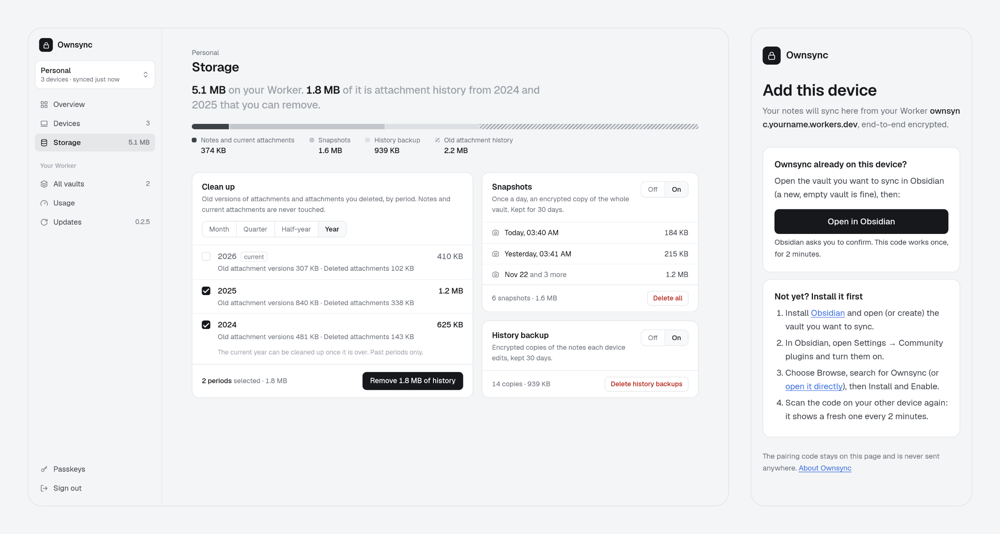
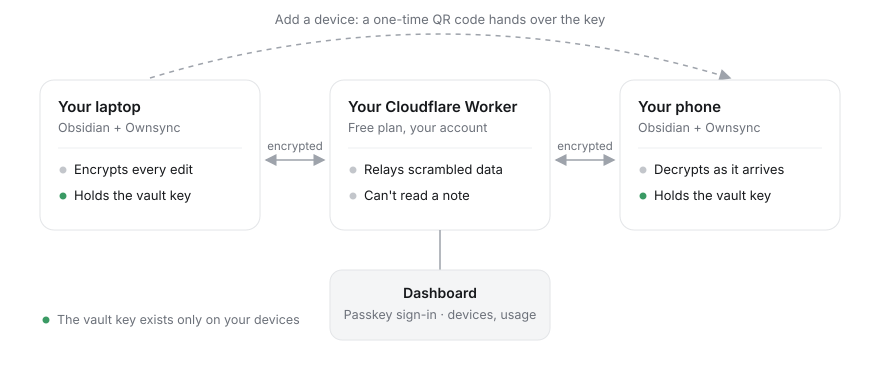

# Ownsync

Real-time sync for Obsidian, end-to-end encrypted, through your own Cloudflare account. **[ownsync.dev](https://ownsync.dev)**

<picture>
<source media="(prefers-color-scheme: dark)" srcset="https://raw.githubusercontent.com/humanglitch191/ownsync/main/docs/images/hero-dark.png">

</picture>

I wanted my notes on my laptop and my phone, in sync as I type, without handing them to anyone. Ownsync runs on a free Cloudflare Worker in your own account. Every edit is encrypted on your device before it leaves, so your Worker only ever holds scrambled data. It couldn't read a note if it tried.

> **Work in progress.** Ownsync is very new, and I'm the only one testing it so far, on my own vault and phone. Expect rough edges, and keep a backup of your vault while you try it.

- **Live.** Edits show up on your other devices in under a second.
- **Yours.** Only your devices hold the key. No account with me, nothing collected.
- **Offline first.** Edit anywhere. It merges when you're back.
- **History.** Earlier versions of each note, Recently deleted notes, and if you turn them on, daily encrypted snapshots of the whole vault on your Worker.
- **Tested hard.** 500,000 random crashes, renames and reconnects, and not one note lost. [Results](https://ownsync.dev/docs/stress-test-results/).
- **Free.** Runs on Cloudflare's free plan. Open source.

## Get started

1. **Deploy.** Press the button and choose a setup key.
2. **Sign in.** Open your Worker's address within 10 minutes, enter the setup key, and add a passkey.
3. **Connect.** Install Ownsync from Obsidian's community plugins, then press **Open in Obsidian** on your dashboard.

To add your phone, scan the QR code under Settings → Ownsync → Add a device. The [setup guide](https://ownsync.dev/docs/setup/) has every step, with screenshots.

## Good to know

- Working with someone else? They can join your vault as a device. They then see and edit every note, and their edits show up live like yours.
- It needs a free Cloudflare account, and the free plan is plenty for one person's notes. For more, Workers Paid is $5 a month. [Cost and limits](https://ownsync.dev/docs/cost-and-limits/).
- The plugin only talks to your Worker. It reads every file in your vault to sync it, and uses the clipboard only when you press Copy. No telemetry, no ads.
- Your Worker sees when your devices connect and how much is stored, never what you wrote. [What it can and can't see](https://ownsync.dev/docs/security/).
- I built Ownsync with AI. The calls on what it should be, and how it keeps notes safe, were mine. [How it was built](https://ownsync.dev/docs/how-it-was-built/).

[ownsync.dev](https://ownsync.dev) · [Setup guide](https://ownsync.dev/docs/setup/) · [Security](https://ownsync.dev/docs/security/) · [Cost and limits](https://ownsync.dev/docs/cost-and-limits/) · [Updating](https://ownsync.dev/docs/updating/) · [Stress test results](https://ownsync.dev/docs/stress-test-results/) · [How it was built](https://ownsync.dev/docs/how-it-was-built/) · [Design notes](https://ownsync.dev/docs/design/) · [Protocol](https://ownsync.dev/docs/protocol/) · [Development](https://ownsync.dev/docs/development/)

MIT © humanglitch191
