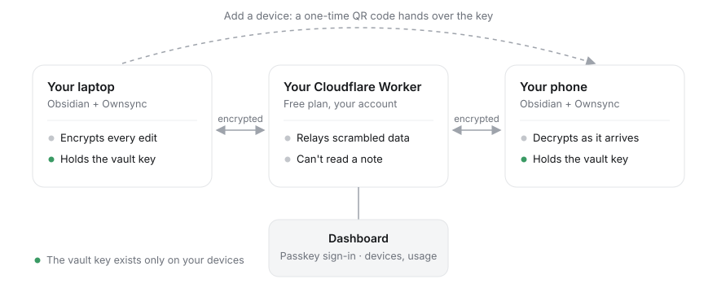
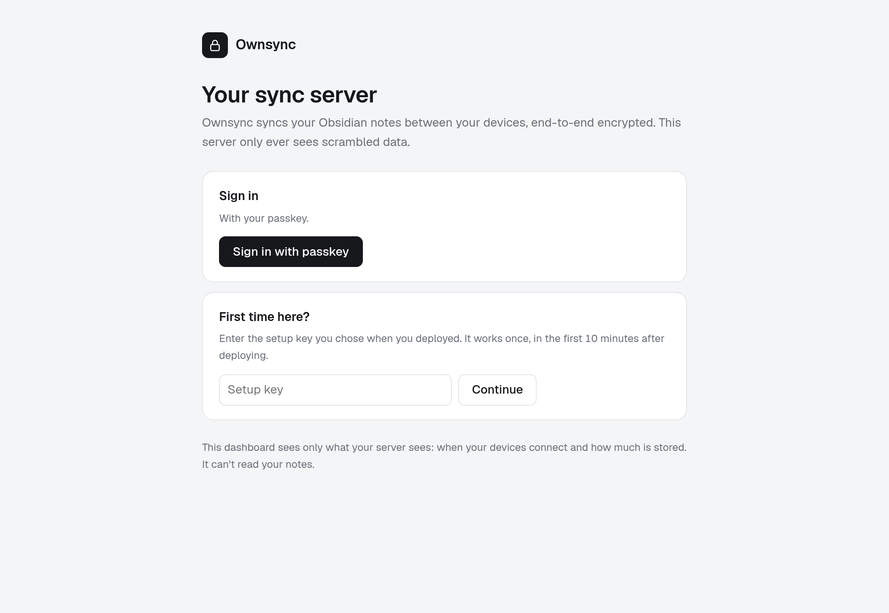
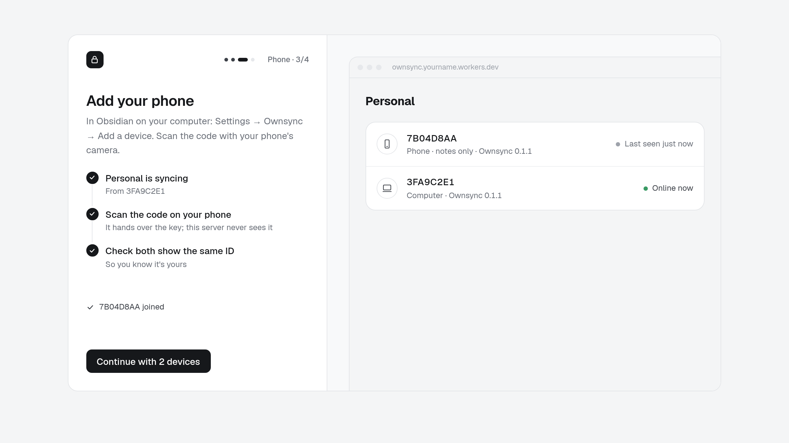
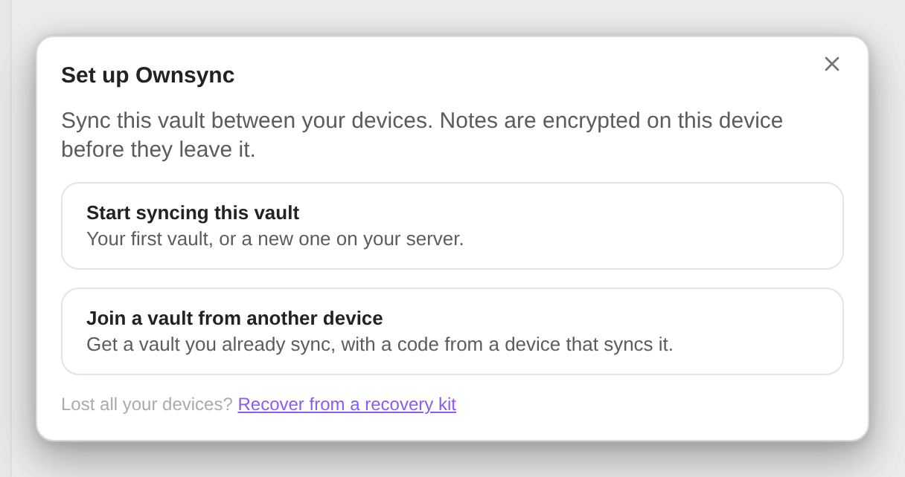
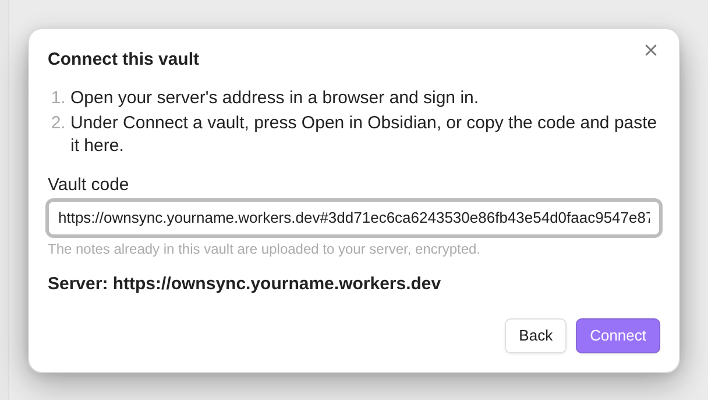
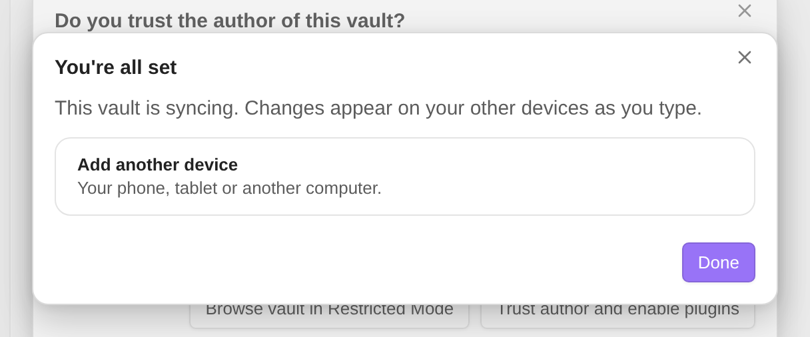
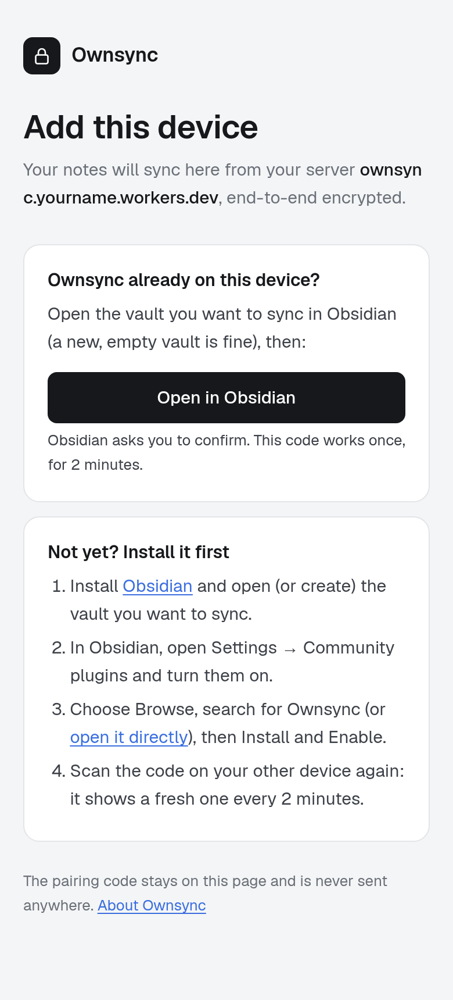
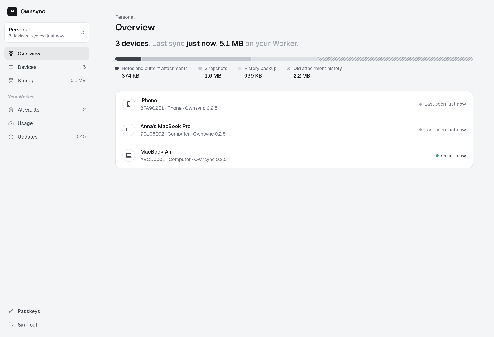

# Setup guide

About five minutes, from your browser and Obsidian.

Your devices encrypt every edit and hold the key. Your Worker, on your own Cloudflare account, only ever relays scrambled data. A one-time QR code carries the key from one device to the next.

## 1. Deploy your Worker

Press the button and sign in to Cloudflare, or create a free account. Cloudflare asks for a name and a **setup key**: a passphrase of at least 12 characters that isn't easy to guess. A few random words work well. When the deploy finishes, Cloudflare shows your Worker's address, like `https://ownsync.yourname.workers.dev`.

**Your own domain** (optional), like `sync.yourdomain.com`, instead of the `workers.dev` address: do it now, before signing in, because your passkey belongs to the address you create it on. In your Cloudflare dashboard, open **Workers & Pages → ownsync → Settings → Domains & Routes → Add → Custom domain** (the domain's DNS has to be on Cloudflare; it's free). Then set a new `SETUP_KEY` under **Settings → Variables and Secrets**, which restarts the 10 minutes, and open your own domain for the next step.

## 2. Sign in and add a passkey

Open the address **within 10 minutes**. Press **First time? Use setup key**, enter it, then create a passkey: your fingerprint, face or device PIN. From then on you sign in with the passkey, and the setup key stops working.

## 3. Connect a vault

Setup carries on in steps on the left, while your dashboard fills in on the right as each device connects.

In Obsidian, open Settings → Community plugins, turn them on, choose **Browse**, search for **Ownsync**, then **Install** and **Enable**. A welcome screen opens.

In the setup steps, press **Open in Obsidian**. Obsidian shows the address of the Worker it's about to connect to, and asks whether this device should **sync attachments too** (images, PDFs and other files) or notes only. Press **Connect**.

Ownsync then offers a **recovery kit**: your Worker's address, vault ID and a recovery code. Save it somewhere safe, printed or in a password manager. It's the only way back in if you lose every device. Your notes start syncing, encrypted.

Another vault? Press **Connect another vault** on your dashboard, or **Add another vault** in Settings → Ownsync, which opens it. The same steps walk you through it, and each vault gets its own key.

## 4. Add your phone and other devices

On a device that already syncs, open Settings → Ownsync → **Add a device**. Scan the QR code with your phone's camera and tap **Open in Obsidian**. On a computer, press **Copy link** and paste it into the new device's welcome screen, under **Join a vault from another device**. Both devices show the new device's ID: check they match.

Each code works once, for 2 minutes, and a fresh one appears while the screen is open. Anyone who scans a code first gets your vault's key, so don't share or screenshot it.

## Your dashboard

Your Worker's address is your dashboard. Pick a vault at the top of the sidebar. **Overview** sums it up in one line and lists its devices by the names you gave them in Obsidian (Settings → Ownsync → Device name), or their random ID until you do: phone or computer, when each was last online, which version it runs, and any conflict copies. **Devices** lets you rename them and add one. **Storage** shows what the vault takes up on your Worker, turns snapshots and history backup on or off, and cleans up old attachment history. Under **Your Worker**: all vaults, how much of Cloudflare's free plan you use, updates and passkeys. From Obsidian: Settings → Ownsync → **Open dashboard**.

<picture>
<source media="(prefers-color-scheme: dark)" srcset="images/dashboard-dark.png">

</picture>

**Moved to your own domain later?** Add the domain as above, set a new `SETUP_KEY`, and set up again at the new address. Your vaults and devices carry on; devices you already connected keep using the `workers.dev` address, which keeps working.

**Missed the 10 minutes, or lost every passkey?** In your Cloudflare dashboard, open Workers → your Worker → Settings → Variables and Secrets, and set a new `SETUP_KEY`. It works for 10 minutes, and the passkey you add with it replaces all the old ones.

## Devices and the recovery key

Settings → Ownsync lists your vault's devices by their short ID.

- **Remove** a device that's lost, stolen or retired. The vault gets a new key the removed device doesn't have. It keeps what it already had, but gets nothing new and can't write. If it was lost or stolen, you also get a new recovery kit.
- **Replace** the recovery key if someone may have seen the code.
- **Recover a vault** on a new device with your recovery kit. Every other device is removed; pair them again afterwards.

## Good to know

- Attachments sync too, up to 20 MB each (Settings → Ownsync → Largest attachment). Each device can sync notes only instead (Settings → Ownsync → Sync attachments): handy on a phone. A notes-only device leaves attachments on your other devices alone.
- When the same note or file changes on two devices while one is offline, both changes are kept. Text merges; anything that can't merge gets a `(conflict …)` copy.
- If Obsidian closes before its last save can be matched, that save is kept as `Note (recovered …).md`.
- Without a recovery kit, losing every device loses the vault: nothing on your Worker can be opened.
- Obsidian's settings folder doesn't sync.
- To stop syncing a device: Settings → Ownsync → **Leave this vault**. Your notes stay as ordinary files.
- **Linux: "Encryption not available"?** That's Obsidian saying it can't find your system keyring, so it keeps secrets (like Ownsync's vault key) unencrypted in its settings folder. Your notes sit unencrypted in the vault folder anyway, so it changes little. On desktops Obsidian doesn't recognise (Hyprland, Sway and others), add the line `--password-store=gnome-libsecret` to `~/.config/obsidian/user-flags.conf` and restart Obsidian. Best done before connecting a vault: after the switch, Obsidian can't read what it saved before, so a vault connected earlier would need adding again.
